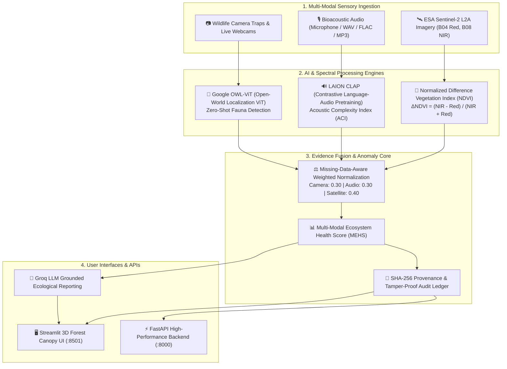

# 🌿🛰️ ECO-MRV AGENT: Autonomous Environmental Intelligence & Satellite Monitoring

[](https://eco-mrv-satellite.onrender.com)
[](https://www.python.org/)
[](https://fastapi.tiangolo.com/)
[](https://streamlit.io/)
[](https://pytorch.org/)
[](https://www.docker.com/)

An end-to-end multi-modal environmental intelligence platform that unifies **ESA Sentinel-2 multispectral satellite imagery**, **zero-shot computer vision (Google OWL-ViT)**, and **canopy bioacoustics (LAION CLAP)** to deliver cryptographically auditable, real-time Measurement, Reporting, and Verification (MRV) for biosphere reserves.

---

## 🚀 Live Deployments

- 🖥️ **Live Web Application (Render)**: [https://eco-mrv-satellite.onrender.com](https://eco-mrv-satellite.onrender.com)
- 🔌 **Interactive API Documentation**: [https://eco-mrv-satellite.onrender.com/docs](https://eco-mrv-satellite.onrender.com/docs)
- 📦 **GitHub Repository**: [https://github.com/princekumarjha83-oss/satellite](https://github.com/princekumarjha83-oss/satellite)

---

## 🗺️ System Architecture

The platform is designed around a multi-tier pipeline integrating sensory data, deep learning inference engines, missing-data-aware evidence fusion, and cryptographic provenance ledgers:



---

## 🌟 Core Features

### 1. 🛰️ Sentinel-2 Multispectral & Temporal Delta Engine
- **Spatial Resolution**: Computes 10m-resolution calibrated vegetation dynamics using Sentinel-2 Level-2A surface reflectance bands (B04 Red, B08 NIR).
- **Temporal Anomaly Tracking**: Analyzes temporal deltas between observation baselines to pinpoint deforestation frontiers, degradation, and forest canopy recovery.
- **Automated Cloud & Water Masking**: Filters invalid pixels to eliminate atmospheric distortion from carbon baseline calculations.

### 2. 🎙️ Bioacoustic Canopy Intelligence (CLAP + ACI)
- **LAION CLAP Integration**: Resamples audio to 48 kHz and evaluates 5-second sliding windows against 26 animal-call taxonomy descriptors and 11 ambient background noise profiles.
- **Acoustic Complexity Index (ACI)**: Computes matrix spectrogram variability to assess ecological biodiversity and canopy density.
- **Noise Rejection**: Skips silent and ambiguous acoustic sequences with dynamic separation thresholds.

### 3. 🐆 Open-Vocabulary Wildlife Detection (Google OWL-ViT)
- **Zero-Shot Animal Localization**: Identifies wildlife in camera traps, video streams, and live webcams without requiring task-specific retraining.
- **Flexible Taxonomic Queries**: Detects critical umbrella and keystone species (Bengal Tigers, Asian Elephants, Indian Leopards, One-horned Rhinos, etc.).
- **Live Video Streaming**: Real-time WebRTC camera frame processing with bounding box visualization.

### 4. ⚖️ Multi-Modal Evidence Fusion & MEHS
- **Renormalization Pipeline**: Dynamically re-weights sensor modalities when an input stream is unavailable, ensuring missing sensors do not bias the score toward zero.
- **Historical Anomaly Engine**: Triggers automated alert statuses when bi-temporal measurements deviate beyond 3 standard deviations from historical baselines.
- **Groq AI Ecological Synthesis**: Converts fused numerical telemetry into natural-language audit narratives for forest conservators and carbon credit regulators.

### 5. 🔐 Cryptographic Ledger & Auditability
- Generates a **SHA-256 cryptographic digest** for every uploaded satellite tile, audio recording, and camera frame.
- Exports audit-ready JSON and Markdown reports with full provenance chains for transparent carbon credit certification.

---

## 📁 Repository Structure

```text
├── .streamlit/
│   └── config.toml               # Streamlit theme & server configuration
├── assets/
│   ├── audio/                    # Reference bioacoustic audio files
│   ├── cameras/                  # Sample camera trap imagery
│   ├── forests/                  # Indian biosphere reserve catalog assets
│   └── videos/                   # Simulation wildlife video feeds
├── Dockerfile                    # Production container specification (Python 3.11-slim + GDAL)
├── render.yaml                   # Render Blueprint deployment specification
├── vercel.json                   # Vercel static gateway configuration
├── start.sh                      # Multi-process entrypoint (FastAPI + Streamlit)
├── index.html                    # Edge web portal for Vercel deployment
├── app.py                        # Streamlit main entrypoint & navigation
├── backend.py                    # FastAPI REST API engine
├── forest_dashboard.py           # Forest reserve monitoring & satellite UI
├── satellite_ndvi.py             # Sentinel-2 multispectral vegetation algorithms
├── satellite_temporal.py         # Bi-temporal change detection & GeoTIFF generation
├── satellite_comparison.py       # Comparative satellite visualization components
├── satellite_evidence.py         # Satellite cryptographic evidence processor
├── animal_audio.py               # LAION CLAP acoustic species classifier
├── bioacoustics.py               # Audio metrics & ACI computation
├── live_camera.py                # OWL-ViT wildlife vision & WebRTC interface
├── ecosystem_pipeline.py         # Multi-modal fusion & MEHS algorithm
├── report_explanation.py         # Groq LLM report generation engine
├── ecomrv_config.py              # Configuration weights & hyperparameter defaults
├── requirements.txt              # Production Python package dependencies
└── tests/                        # Comprehensive test suite
```

---

## 💻 Local Setup & Installation

### Prerequisites
- Python 3.10 or 3.11
- Git
- Modern browser (Chrome / Edge / Firefox)

### 1. Clone the Repository
```bash
git clone https://github.com/princekumarjha83-oss/satellite.git
cd satellite
```

### 2. Set Up Virtual Environment
```bash
# Windows (PowerShell)
python -m venv .venv
.\.venv\Scripts\Activate.ps1

# Linux / macOS
python3 -m venv .venv
source .venv/bin/activate
```

### 3. Install Dependencies
```bash
pip install --upgrade pip
pip install -r requirements.txt
```

### 4. Configure Environment Variables
Copy `.env.example` to `.env` and configure your API keys:
```bash
cp .env.example .env
```
Edit `.env`:
```ini
GROQ_API_KEY=your_groq_api_key_here
```

### 5. Run the Application
Start the Streamlit interface:
```bash
streamlit run app.py
```

*(Optional)* Run the FastAPI backend server in a separate terminal:
```bash
uvicorn backend:app --host 127.0.0.1 --port 8000 --reload
```

Access the dashboard at **`http://localhost:8501`** and the API documentation at **`http://localhost:8000/docs`**.

---

## ☁️ Cloud Deployment

### Deploying on Render (Recommended)
This repository includes a production-ready `Dockerfile` and `render.yaml` configured to run both the FastAPI API and the Streamlit interface within a single container:

1. Sign in to [Render](https://render.com) using your GitHub account.
2. Click **New +** → **Web Service**.
3. Select the repository **`princekumarjha83-oss/satellite`**.
4. Configure settings:
   - **Runtime**: `Docker`
   - **Branch**: `main`
   - **Environment Variables**:
     - `PORT`: `8501`
     - `GROQ_API_KEY`: *(Your Groq API key)*
5. Click **Create Web Service**. Your service will build and go live at `https://<your-service-name>.onrender.com`.

### Deploying on Vercel (Web Showcase & Portal)
1. Sign in to [Vercel](https://vercel.com) and click **Add New...** → **Project**.
2. Import **`princekumarjha83-oss/satellite`**.
3. Set **Application Preset** to **`Other`**.
4. Click **Deploy**. Vercel will deploy the edge portal in seconds, embedding the live Render app.

---

## 🧪 Testing

Execute the comprehensive unit and integration test suite:

```bash
# Run wildlife and audio detection tests
python -m unittest test_wildlife test_animal_audio test_pages test_wildlife_reporting -v

# Run multi-modal ecosystem scoring tests
python -m unittest test_ecosystem_pipeline -v
```

---

## 📜 Research & Architecture References
- **ESA Copernicus**: [Sentinel-2 Level-2A Processing Baseline](https://sentinels.copernicus.eu/web/sentinel/user-guides/sentinel-2-msi)
- **Google Research**: [OWL-ViT Open-World Detection](https://huggingface.co/docs/transformers/model_doc/owlvit)
- **LAION Audio**: [CLAP Contrastive Language-Audio Pretraining](https://huggingface.co/docs/transformers/model_doc/clap)
- **Groq**: [LPU Inference Engine](https://groq.com)

---

<p align="center">
  <b>Made with ❤️ by Prince Kumar Jha</b>
</p>